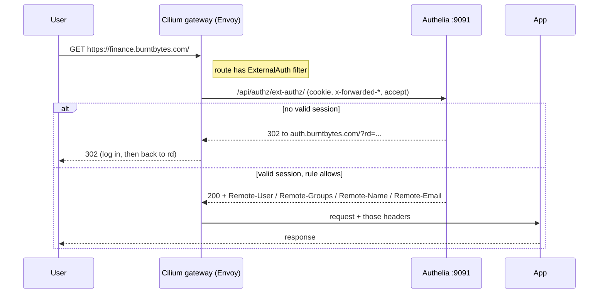

# Gateway authentication (Gateway API ExternalAuth + Authelia)

How the Cilium gateway puts Authelia in front of apps that have no login of their own.

**The model is per-route.** An HTTPRoute opts in by carrying an `ExternalAuth` filter. A route
without the filter is never checked by Authelia, whatever Authelia's `access_control` rules say.

This replaced a gateway-wide Envoy `ext_authz` patch (`CiliumClusterwideEnvoyConfig`) that was never
injected on Cilium 1.15–1.19, so nothing it was meant to gate was gated. See
[the 2026-02-27 incident](../operations/incidents/2026-02-27-navidrome-ext-authz-gateway-api-broken.md),
HOMELAB-90, and [the Cilium 1.20 plan](../plans/2026-11-04-cilium-1-20-external-auth-plan.md). The
filter needs Cilium 1.20 and the experimental-channel HTTPRoute CRD (`infra/crds/gateway-api/`).

## What is gated

| Host | Route | Notes |
|---|---|---|
| prometheus.burntbytes.com | `infra/controllers/kube-prometheus-stack/httproute.yaml` | `/-/healthy` bypassed |
| alerts.burntbytes.com | same file | `/-/healthy` bypassed |
| ladder.burntbytes.com | `apps/base/ladder/httproute.yaml` | `/api/edgar/health` bypassed |
| finance.burntbytes.com | `apps/base/finance-dashboard/httproute.yaml` | never deploy this route without the filter |
| navidrome.burntbytes.com | `apps/production/navidrome/httproute.yaml` | SSO; `/rest` and `/auth` ungated (below) |
| navidrome.stage.burntbytes.com | `apps/staging/navidrome/httproute.yaml` | same as prod |

**Not gated, although Authelia has a `one_factor` rule for them:** chat. and chat.stage. They rely on the app's own login. The rules are dormant until a route gets the filter.

The bypassed health paths exist so Homepage's status dots keep reporting app health, not the
Authelia redirect. They are Authelia rules (`policy: bypass` with `resources:`), listed before the
host's `one_factor` rule.

## Request flow



## One login covers every gated host

The session cookie is set on the parent domain (`session.cookies[].domain: burntbytes.com`, and
`stage.burntbytes.com` on staging). So one Authelia login is valid on every gated host until the
session ends: `expiration: 1h`, `inactivity: 15m`, or 30 days with *remember me*.

Every gated host uses `policy: one_factor`, so any Authelia user can open all of them. To limit a
host to some users, add `subject: group:<name>` to its rule, or `two_factor` to require 2FA.

## Adding the gate to a route

1. Add the filter to the route's rule. Copy it from `apps/base/ladder/httproute.yaml`:

   ```yaml
   filters:
     - type: ExternalAuth
       externalAuth:
         protocol: HTTP
         backendRef:
           name: authelia
           namespace: authelia-prod        # authelia-stage on staging
           port: 9091
         http:
           path: /api/authz/ext-authz/     # trailing slash required, see below
           allowedHeaders: [cookie, x-forwarded-proto, x-forwarded-for, accept]
           allowedResponseHeaders: [remote-user, remote-groups, remote-name, remote-email]
   ```

2. Add the route's namespace to `from:` in `apps/{production,staging}/authelia/referencegrant.yaml`.
   Without it the cross-namespace `backendRef` is refused and the route reports `ResolvedRefs=False`.
3. Add a `one_factor` rule for the host in `apps/{production,staging}/authelia/configuration.yaml`.
   `default_policy` is `bypass`, so without a rule Authelia lets everything through.
4. Bypass any path a monitor polls, before the host's main rule.
5. After merge: unauthenticated GET → 302 to auth., logged-in browser → 200, and route
   `Accepted` + `ResolvedRefs` both True.

## Details that bit us

- **Trailing slash on `path`.** Without it Authelia sees a path with no leading `/` and answers
  400, then the browser loops on 301s. Fixed in #1827.
- **`authelia_url` on the session cookie.** Authelia 4.39 answers the authz endpoint with a bare 401
  unless the cookie entry names the portal URL. With it, it answers 302 to the portal.
- **Forged identity headers.** On a gated rule the gateway replaces a client-sent `Remote-User` with
  Authelia's value (tested on staging). An ungated rule does not, so strip it explicitly.
  Navidrome's `/rest` rule (Subsonic clients, no browser cookie) and `/auth` rule each have a
  `RequestHeaderModifier` that removes `Remote-User`.
- **Apps that log request headers.** Navidrome logs every header on a failed login, which would
  include the Authelia session cookie. Its `/auth` rule is ungated and also removes `Cookie`.
- **Apps that trust `Remote-User`** must trust it only from the gateway: Navidrome sets
  `ND_EXTAUTH_TRUSTEDSOURCES` to the four per-node Cilium ingress IPs, not the private ranges.
  See [the Navidrome runbook](../operations/apps/navidrome.md#10-authentication).

## Known upstream issue

cilium/cilium#49132 (open on 1.20): removing an HTTPRoute that has an ExternalAuth filter can make
unrelated routes answer 403 on existing connections. Avoid deleting gated routes casually; when you
must, do it in a quiet window and then check a few ungated hosts (home., hass.) return 200.
